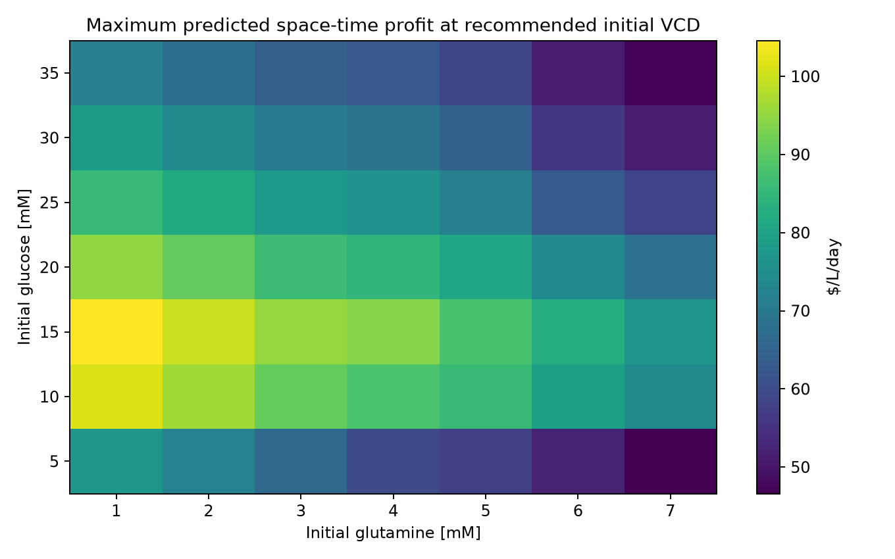
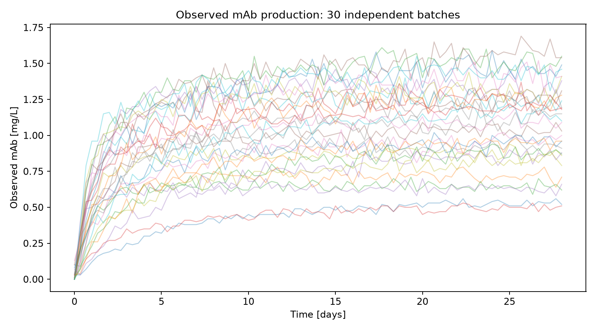
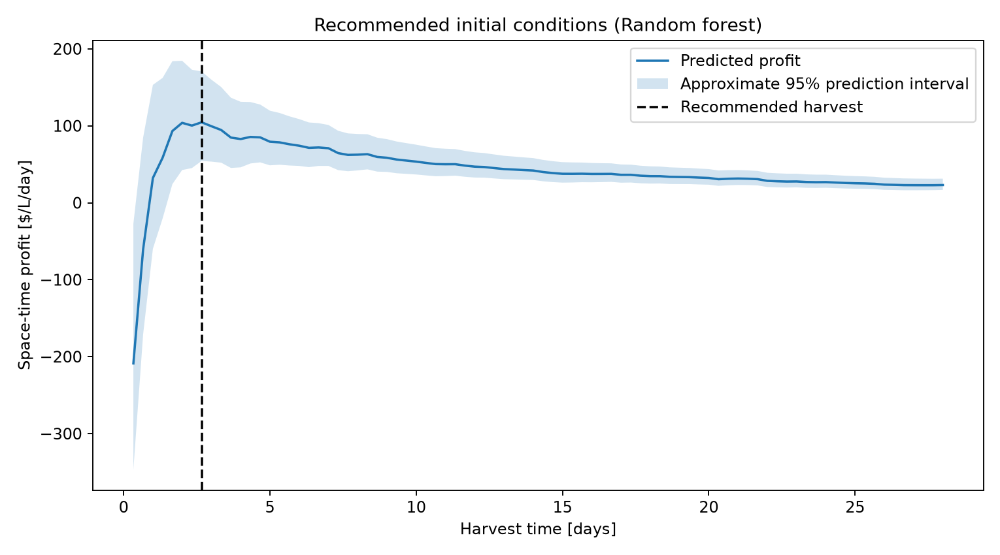

# Monoclonal Antibody Production Profit Optimization

This project estimates economically favourable operating conditions for a one-litre monoclonal antibody (mAb) production process. Python code selects a structured set of 30 simulated bioreactor batches, compares predictive regression models, and estimates mAb concentration over time from the initial culture settings. It then searches feasible glucose, glutamine, inoculum density, and harvest-time choices for the highest predicted profit per litre of reactor capacity per day.

## Highlights

- **Designed** a reproducible, 30-run experimental sampling plan across three initial culture variables.
- **Developed** batch-aware model validation that separates whole bioreactor runs between training and evaluation.
- **Compared** polynomial ridge regression and random forest regression using out-of-fold prediction errors.
- **Optimized** initial culture settings and harvest timing using process costs, product value, and reactor downtime.
- **Reported** estimated financial outcomes with approximate 95% prediction intervals and exported supporting evidence.

## Environment

- Python 3.14.7
- matplotlib 3.11.0
- NumPy 2.5.2
- pandas 3.0.5
- scikit-learn 1.9.0

Run the analysis from the repository root with `python main.py` in an environment containing the listed dependencies. The separate `src/select_batches.py` utility is used only when first preparing the datasets from the original batch library.

## Code Design

### Program entry point and separation of responsibilities

The executable entry point is `main.py`. It deliberately contains very little code: it identifies the project root and calls `run()` from `src/analysis.py`. This keeps analysis logic in one reusable module while preserving a simple, predictable command for anyone inspecting the project. Running `main.py` does not download data or change the choice of batches; it reads the 30 CSV files already placed in `datasets/`. Source code, input datasets, tables, and graphs are kept in separate folders so the results are easy to trace. This organization allows another user to rerun the numerical work and inspect the results without sorting through a single large script.

### Experimental data selection and provenance

The dataset is prepared separately with `src/select_batches.py`. The utility reads the 1,029 available initial-condition records, finds the seven studied levels for each of three inputs, and chooses 30 distinct combinations. Eight cover the extreme corners, six cover the centres of the parameter-space faces, one covers the overall centre, ten are distributed within the boundaries using a maximum-minimum-distance strategy, and five are sampled randomly from the remaining combinations. A fixed random seed of 42 is used to reproduce tie-breaking, the final five selections, and the selection of one replicate from each available three-replicate setting. The selected batch IDs and their sampling categories are saved to `tables/selected_batches.csv`. This preparatory stage records which experiments were used and makes the small data budget transparent.

### Loading and checking the time series

At execution, the analysis code reads `datasets/initial_conditions.csv` and checks that exactly 30 `batch_####.csv` files exist. Each filename supplies its batch identifier, which is matched to the initial glucose concentration, glutamine concentration, and viable cell density. Every batch file is sorted by measurement time, and hours are converted into days. The data are then combined into one table while retaining a batch ID for every observation. Missing values in the modeling inputs or target cause an error, and negative time is rejected. These checks catch common mistakes such as using the wrong input files or losing the connection between batch measurements and initial operating settings.

### Predictor and target construction

The regression inputs are initial glucose in mM, initial glutamine in mM, initial VCD in cells/mL, and elapsed time in days. The objective is to predict accumulated mAb concentration in mg/L. The model is trained on mAb concentration divided by elapsed time, which is the time-averaged production rate, instead of training directly on concentration. Predictions are multiplied by elapsed time to recover concentration. Measurements at time zero are excluded from training because the rate would require division by zero. This design also makes the reconstructed concentration zero at time zero, consistent with the stated initial conditions, despite possible small simulated measurement noise. Negative reconstructed mAb values are clipped to zero to avoid negative product values during optimization.

### Candidate regression models and validation

Three candidate models are compared: a degree-two polynomial followed by ridge regression (`alpha=10`), a degree-three polynomial followed by ridge regression (`alpha=30`), and a random forest with 200 trees, at least three observations per terminal leaf, and `max_features=1.0`. Ridge pipelines first standardize the predictors, then construct polynomial features, then fit regularized linear coefficients. Scaling is fitted within each training fold, which avoids leakage from held-out observations. The forest learns nonlinear partitions without explicitly creating polynomial terms. Five-fold `GroupKFold` validation uses the batch identifier as the grouping variable. All measurements from an individual batch are therefore either in training or held out for a given fold, rather than artificially treating adjacent time points as independent experiments.

### Selecting the final model and estimating uncertainty

For each architecture, the code reconstructs out-of-fold mAb predictions and calculates root-mean-square error (RMSE) and the coefficient of determination (R²) in concentration units. Models are ranked by RMSE, and the lowest-error architecture is retrained using all 30 selected batches. Its held-out residuals, calculated before full-data fitting, supply empirical 2.5th and 97.5th percentile offsets for prediction intervals. Adding those offsets to each final prediction provides simple, approximate pointwise 95% intervals. The code saves the complete out-of-fold predictions and residuals, so the interval calculation can be inspected. These intervals do not account for every source of uncertainty, particularly model selection and the search for the maximum.

### Economic calculation and numerical search

The program constructs the 343 unique initial-condition combinations in the provided seven-by-seven-by-seven grid and pairs them with each positive harvest time appearing in the measured data. For every candidate, the fitted model predicts mAb, and the code calculates culture cost using the specified nutrient and inoculum charges. Product value is $1,000 for each predicted mg/L of mAb, so profit per litre equals value minus initial culture cost. Space-time profit divides this profit by harvest days plus the required one day of reactor downtime. Space-time yield uses the same denominator but has mg/L/day units. Predictions and uncertainty bounds are passed through the same equations. The candidate with the largest predicted space-time profit is selected, and the program exports the recommended settings, 20 leading options, and best harvest choice for each initial-condition combination.

### Exported evidence and repeatability

The analysis writes `tables/model_comparison.csv`, `tables/held_out_predictions.csv`, `tables/profit_by_initial_conditions.csv`, `tables/top_20_options.csv`, `tables/recommended_conditions.csv`, `tables/results_summary.txt`, and `tables/environment_versions.txt`. Three PNG graphics show the measured mAb trajectories, predicted profit versus harvest time for the recommended settings, and a glucose–glutamine profit heatmap at the recommended initial VCD. Numeric outputs and images come from the same run, avoiding manual recalculation when results change. A version file records the actual Python and library versions, and a fixed random seed makes the selection and random forest fitting repeatable on the same software environment.

## Analysis

### Engineering objective and economic trade-off

The practical target is not simply the greatest concentration of monoclonal antibody at the end of a batch. The objective is profit generated per unit reactor volume and calendar time. A very long batch may collect more product but prevent the reactor from beginning the next batch; a short batch may have high turnover but fail to recover the initial nutrient and inoculum expenses. The one-day downtime creates an additional penalty for very short production cycles. Product value is defined as 1,000 times mAb in mg/L, culture cost depends on the three starting variables, and the reactor capacity is one litre. Consequently, the objective has units of dollars per litre per day, while space-time yield is mg/L/day. These measures should be considered together: greater physical productivity does not guarantee greater profitability if the additional production requires sufficiently expensive initial media or cells.

The cost equation also provides useful benchmarks before fitting any model. Raising initial glucose by 1 mM adds $10/L of cost, raising glutamine by 1 mM adds $20/L, and raising initial VCD by 100,000 cells/mL adds $50/L. These are direct cost effects given by the problem; their benefits for product production must be learned from the batch data. Because the resulting mAb concentration and preferred harvest day may change together, comparing operating settings solely at a fixed final time would miss the operating trade-off. The program instead evaluates a harvest-time choice for every candidate setting and ranks candidates by the complete economic objective.

### Justification for the 30 experiments

The experimental budget covers only 30 of the 1,029 available simulated runs, so selecting the most convenient files would use that budget poorly. I chose an explicit mixture of structured coverage and random sampling. The eight corner combinations provide examples of the joint minimum and maximum levels for the three controllable initial variables. They are helpful for determining whether an apparently attractive optimum lies near the limits of the process space. Six face centres isolate how the response behaves when one variable is at a boundary but the other two remain central. The overall centre adds a reference operating point away from all boundaries. Together, those 15 points cover the global geometry of the operating space before any remaining batches are allocated.

For the next ten, a maximin-style algorithm selects combinations strictly inside the studied ranges that are far from previously selected points in normalized three-dimensional coordinates. Normalization matters: VCD is numerically much larger than the nutrient concentrations, so Euclidean distances in raw units would almost entirely reflect VCD. The algorithm uses the same fixed seed to resolve distance ties. Finally, five additional settings are sampled without replacement from all remaining locations. These random points provide some independent variety and reduce dependence on a completely hand-designed set. The script then randomly chooses one of the three available replicates for each selected combination, giving 30 unique operating settings rather than repeating the same setting several times.

This design prioritizes broad operating-condition coverage, which is appropriate when a surrogate model must compare many conditions. It also has limitations. With one replicate per setting, the model does not directly quantify batch-to-batch repeatability at a fixed condition. Thirty independent batches remain a small training sample even though each contains many time measurements. The later time points are correlated within each batch and cannot be treated as independent experiments. A follow-up study should use new batches to verify the predicted optimum, ideally including replicates around high-profit settings and near the recommended harvest time.

### Choice of model architecture and validation procedure

The output depends on substrate availability, initial cell concentration, elapsed time, and likely nonlinear biological responses. This motivates comparing a low-complexity polynomial family against a more flexible tree ensemble rather than selecting an architecture without testing it. Degree-two ridge regression can represent curvature and pairwise interactions, while degree-three terms permit more complicated response surfaces. Ridge regularization limits the size of fitted coefficients and can reduce instability where the dataset is small relative to the number of polynomial terms. The polynomial pipelines standardize inputs before generating the features because 1 mM and hundreds of thousands of cells/mL would otherwise be incomparable scales. The forest is a separate, reasonable alternative that can learn local thresholds and interactions without imposing a global polynomial equation.

The tested hyperparameters were fixed in advance as practical choices, not advertised as an exhaustive search. The two ridge models use degrees 2 and 3 with regularization strengths 10 and 30. The forest has 200 trees, a minimum leaf size of 3, and all candidate predictors available at a split; its seed is 42. More trees help stabilize ensemble averaging, while the leaf-size constraint moderates very small terminal regions. However, those settings should not be called mathematically optimal. A nested, batch-grouped hyperparameter search and a separate holdout set would be stronger choices if additional batches were available. In this limited-data project, comparing several reasonable architectures while keeping validation batch-aware provides an understandable baseline.

### Comparison of actual model performance

Performance was compared using five-fold grouped cross-validation on entire batches. This is an important decision: ordinary row-level random splits would put nearby observations from the same bioreactor in both training and test data, giving an overly favourable impression of generalization. Grouped validation tests prediction of the trajectories of batches not used for fitting in that fold. RMSE, in mg/L, quantifies the typical scale of concentration error, and R² shows improvement relative to a constant mean prediction. The results from this specific 30-batch selection are:

| Architecture | Held-out RMSE (mg/L) | Held-out R² |
|---|---:|---:|
| Random forest | 0.112 | 0.879 |
| Ridge polynomial (degree 3) | 0.391 | -0.466 |
| Ridge polynomial (degree 2) | 0.563 | -2.053 |

The lowest-error architecture is **Random forest**, with out-of-fold RMSE **0.112 mg/L** and R² **0.879**. A positive R² indicates performance better than a constant mean prediction on the combined held-out observations; negative R² indicates worse performance than that baseline. The polynomial models provide valuable comparison points rather than being dismissed simply because the forest performed better. Their fixed global polynomial assumptions may be poorly matched to the observed trajectories and the limited diversity of independent batches. Conversely, the forest can represent nonlinear responses but does not extrapolate reliably beyond the studied variable ranges. The main result is therefore a model comparison for this specific dataset and validation design, not a guarantee that the forest will outperform polynomial models in all bioreactors.

### Effect of initial conditions on profit and yield

To examine the three input factors without relying only on one winning point, the code evaluated each of the 343 combinations of initial glucose, glutamine, and VCD. For each combination, it retained the harvest time that maximized **predicted space-time profit**. The following marginal summaries then average those profit-optimal values over the 49 combinations of the other two initial inputs. The yield column uses the harvest time selected for profit, not the separate harvest time that would necessarily maximize yield. Therefore these tables describe a model-based operating screen and should not be interpreted as isolated experimental causal effects.

| Input | Setting | Mean optimized profit ($/L/day) | Mean yield at profit-optimal harvest (mg/L/day) |
|---|---:|---:|---:|
| Glucose (mM) | 5 | 30.91 | 0.118 |
| Glucose (mM) | 10 | 50.51 | 0.173 |
| Glucose (mM) | 15 | 59.57 | 0.188 |
| Glucose (mM) | 20 | 58.33 | 0.189 |
| Glucose (mM) | 25 | 50.93 | 0.181 |
| Glucose (mM) | 30 | 44.89 | 0.174 |
| Glucose (mM) | 35 | 39.35 | 0.156 |
| Glutamine (mM) | 1 | 57.61 | 0.173 |
| Glutamine (mM) | 2 | 54.41 | 0.169 |
| Glutamine (mM) | 3 | 51.81 | 0.174 |
| Glutamine (mM) | 4 | 48.52 | 0.175 |
| Glutamine (mM) | 5 | 45.27 | 0.170 |
| Glutamine (mM) | 6 | 40.20 | 0.162 |
| Glutamine (mM) | 7 | 36.64 | 0.157 |
| VCD (cells/mL) | 200,000 | 36.29 | 0.086 |
| VCD (cells/mL) | 400,000 | 66.56 | 0.158 |
| VCD (cells/mL) | 600,000 | 74.90 | 0.222 |
| VCD (cells/mL) | 800,000 | 54.06 | 0.208 |
| VCD (cells/mL) | 1,000,000 | 34.16 | 0.161 |
| VCD (cells/mL) | 1,200,000 | 40.18 | 0.178 |
| VCD (cells/mL) | 1,400,000 | 28.32 | 0.167 |

For **initial glucose**, the mean optimized profit across the 49 combinations of the other two inputs is $30.91 per L/day at the lowest studied setting (5), and $39.35 per L/day at the highest (35). The input level with the highest mean predicted profit is 15, averaging $59.57 per L/day. These are *model-derived marginal summaries*, not directly measured independent effects.

For **initial glutamine**, the mean optimized profit across the 49 combinations of the other two inputs is $57.61 per L/day at the lowest studied setting (1), and $36.64 per L/day at the highest (7). The input level with the highest mean predicted profit is 1, averaging $57.61 per L/day.

For **initial VCD**, the mean optimized profit across the 49 combinations of the other two inputs is $36.29 per L/day at the lowest studied setting (200,000), and $28.32 per L/day at the highest (1,400,000). The input level with the highest mean predicted profit is 600,000, averaging $74.90 per L/day.

The relevant physical interpretation is that nutrient supply may support metabolic activity, while a larger inoculum can change the culture's production trajectory. The model does not directly test those biological mechanisms, however, so statements about precisely *why* a setting is profitable would require additional process measurements or experiments. Initial glucose and glutamine also increase media cost independently of any possible production benefit. Higher initial VCD likewise increases inoculum cost before any product has accumulated. The plotted relationship among glucose, glutamine, and predicted profit is conditional on the recommended VCD, so its colour scale should not be interpreted as a universal response for every inoculum level.

### Recommended operation and predicted economics

The selected settings maximize the model's estimated space-time profit over the original seven-level initial-condition grid and the positive observed harvest times, not over every physically possible concentration or continuous harvest time. The recommended operating point is **15.000 mM glucose**, **1.000 mM glutamine**, and **600,000.000 cells/mL initial VCD**. The recommended harvest occurs at **2.667 days**, equivalent to about **64 hours**, followed by the specified one day of downtime. The predicted mAb concentration at harvest is **0.853 mg/L**. The following table reports all requested outputs, including approximate 95% pointwise prediction intervals:

| Quantity | Model estimate | Approximate 95% prediction interval |
|---|---:|---:|
| Initial glucose | 15.000 mM | — |
| Initial glutamine | 1.000 mM | — |
| Initial VCD | 600,000 cells/mL | — |
| Harvest time | 2.667 days | — |
| Cell culture cost | $470.00/L | — (specified cost equation) |
| Cell culture value at harvest | $853.40/L | $669.40 to $1,095.38/L |
| Space-time profit | $104.56/L/day | $54.38 to $170.56/L/day |
| mAb space-time yield | 0.233 mg/L/day | 0.183 to 0.299 mg/L/day |

The numerical consistency can be checked directly. For the recommended point, the culture costs $470.00 per litre, its estimated value is $853.40 per litre, and its estimated batch profit is $383.40 per litre. Dividing by 3.667 days (harvest plus downtime) gives the reported **$104.56/L/day**. Dividing the predicted 0.853 mg/L of product by the same cycle time gives **0.233 mg/L/day**. The harvest-time graphic displays how profit changes with the selected input conditions and marks the recommended time. The observed-trajectory graphic separately displays all 30 training runs, allowing comparison with the predicted timing and magnitude of mAb production.

### Interpretation of prediction intervals and limitations

The stated 95% prediction intervals are **approximate empirical pointwise intervals** based on the 2.5th and 97.5th percentiles of residuals from held-out batch predictions. The residual bounds are added to predicted mAb concentration, clipped at zero, and then converted to value, profit, and yield using the same economic equations. This makes the interval arithmetic consistent, but does not provide a formal 95% coverage guarantee for a new batch. Errors can change with harvest time and inoculum setting, and measurements within a batch are correlated. The method also uses the same observations for model comparison and for residual calibration, and it does not account for the optimism introduced by searching thousands of possible candidate schedules for the single largest estimate.

Other limitations include the restriction to the seven input levels appearing in the source data, the relatively small number of independent batch runs, the lack of repeated experiments at selected conditions, and the simplified economic model. The predictor uses starting conditions and time rather than measured future glucose depletion, accumulated waste products, or time-varying cell viability. This is useful for an advance batch-planning decision, but it means the model cannot respond to a process disturbance after startup. A full deployment study would check external batches, examine uncertainty near the optimum, and revisit the economic assumptions. Accordingly, the recommended point is a reasoned **model-based candidate for experimental confirmation**, not a proven global optimum.

